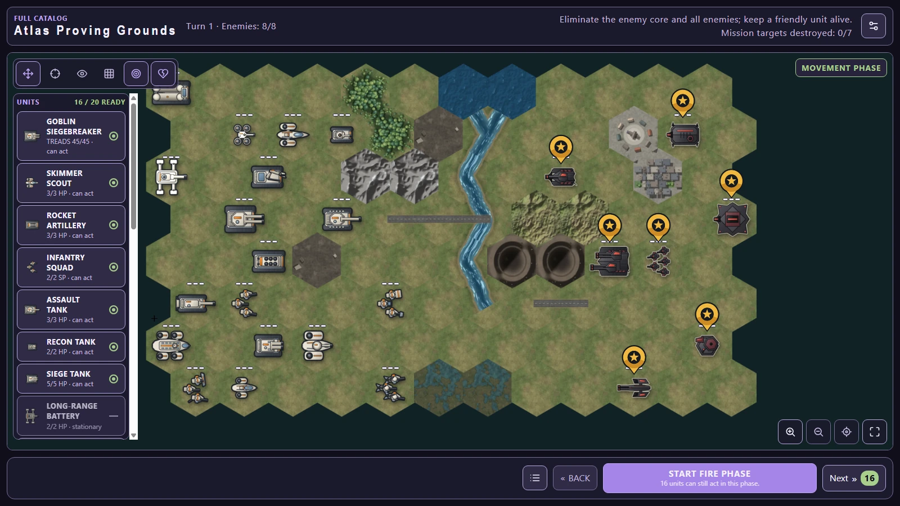

# G.O.B.L.I.N. — Field Test

G.O.B.L.I.N. steht für **Ground Operations, Battlefield Logistics & Intelligence Network**. Der Browserprototyp ist ein rundenbasiertes Taktikspiel auf einer Hexkarte. Versionsbasis ist [v0.1.31](CHANGELOG.md#0131---2026-11-16).



[Herkunft und Prüfung der Aufnahme](reports/TEST_HANDOFF.md#readme-aufnahme-build-31)

## Lokal starten

```powershell
node server.mjs
```

Danach [localhost:4173](http://localhost:4173) öffnen. Der Spieleinstieg ist `index.html`. Das Repository enthält die zum Spielen benötigten Assetableitungen. Build und Spiel laden keine Dateien aus dem privaten Content-Repository.

## Spielen

- **Levelwahl.** Fünf Vollkatalog-Missionen beginnen mit FULL Atlas Proving Grounds. Die Levelwahl bietet außerdem Iron Dust V2, die Field-Test-Missionen und Showcases sowie die Transport-, Spezialisten-, Artillerie-, Belagerungs- und Skimmer-Szenarien. Jede Mission verwendet ihr eigenes zugelassenes Regelprofil.
- **Kampagnen und Tutorial.** Relay Line enthält zwei, Scorched Earth zwölf Missionen. Das Tutorial in der Startansicht führt durch T01 und T02. T03 ist als eigene Lektion in der Levelwahl verfügbar.
- **Sitzwahl und Rundenanalyse.** FULL und Iron Dust V2 führen die Sitzübergabe im nativen Profil aus. Die Auswahl richtet sich nach den für den Sitz zugelassenen Strategien. Trainierte Modelle stehen für den Angriff bereit. Die Spieleransicht gibt nur sichtbare Ereignisse frei. Zuschauer und die Auswertung nach Missionsende können die aufgezeichneten Entscheidungen einsehen.
- **Editor und eigene Level.** Der Editor kann eine Mission vorbereiten und im Browser speichern. Austauschformat sind `goblin-level-v3` und Pakete im Format `goblin-level-package-v3`. Die Levelwahl öffnet gespeicherte Missionen unter »Eigene Level«.
- **Befehle.** Einheit auswählen, Aktion wählen, ein Ziel prüfen und ausführen. Das Spiel zeigt nur die im jeweiligen Regelprofil verfügbaren Befehle. Bewegungs-, Feuer- und Skimmer-Manöverphasen setzen ihren jeweiligen Befehlsraum.

## Regeln, Tests und Build

Die [Projektdokumentation](docs/README.md) führt die [Regelmatrix](docs/RULE_MATRIX.md), die Architektur und die aktuellen Herkunftshinweise. [Content & Asset Notices](docs/CONTENT-NOTICES.md) dokumentiert die verwendeten Grafiken und Modelle.

```powershell
node scripts/verify-release.mjs
node scripts/run-tests.mjs
node scripts/run-tests.mjs --slow
```

Die erste Testsuite prüft unter anderem native Befehle, Sitzübergabe, Tutorial und Editor. Die langsame Suite enthält aufgezeichnete Produkt-Replays. Für beide zusammen dient `node scripts/run-tests.mjs --all`. Trainingslektionen und Skripte liegen unter `assets/training/`. Aufgezeichnete Befehle werden mit den zugehörigen Profilen und Checkpoints geprüft.

[Changelog](CHANGELOG.md) und [Test-Handoff](reports/TEST_HANDOFF.md) ordnen Version und Prüfumfang zu. GitHub Pages prüft den Build vor der Bereitstellung. `scripts/package-itch.py` baut ein HTML5-Paket aus einem gepinnten Release-Tag.
