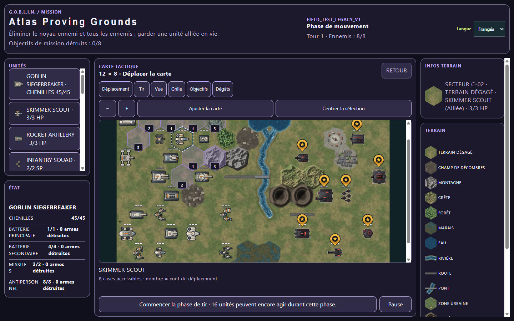

# G.O.B.L.I.N — Field Test

G.O.B.L.I.N steht für **Ground Operations, Battlefield Logistics & Intelligence Network**. Dieses Repository enthält einen eigenständigen Browser-Prototypen für eine rundenbasierte Hexfeld-Taktikmission mit eigener UI, SVG-Karte und frei entwickelten Einheitenmarkern.

## Aktueller Stand

Öffentlich bestätigt ist **0.1.26 / Build 26**, Tag `v0.1.26` auf `195c2bc5a0c8dd97d6263430114d183cfd2aa082`; Remote-main, annotiertes Tag und öffentliche Builddaten wurden am 30.10.2026 erneut lesend geprüft. Dieser Stand bleibt der Rückfallpunkt.

**0.1.27 / Build 27 ist das erste lokale Releasepaket vom 30.10.2026.** Es verwendet die unabhängig abgenommene, eingefrorene Runtime `df1ba35d935971f7cc28835ae7d8d32f3d65178a`. Der Desktoprelease ist bereits bedingt beauftragt; finale Paketprüfung beider Testerrollen, Legal-Endreview, neues echtes README-Bild und öffentliche Auslieferung stehen aus. Aus diesem Paket wurde kein Push, neues Tag oder Deploy durchgeführt.

Der normale V2-Einstieg bietet fünf FULL-Missionen (`catalog-full-atlas`, `catalog-full-terrain-course`, `catalog-full-advance`, `catalog-full-siege`, `catalog-full-specialists`) mit dem genehmigten 26er-Projektregelprofil einschließlich Systemen, Engineering, Transport/Drohnen, Sicht/Tarnung, Feuer-/Raketenregeln und festen Verstärkungen. Drei kurze T01–T03-Lektionen führen durch Auswahl, Vorschau/Abbruch, Bewegung/BACK, Feuer/Phasen und Gelände/Sicht; Rückblick, Wiederholen und Missionswechsel sind integriert. Die Lektionen behalten ihre festen Field-Test-Werte. Historische Missionen/Piloten und der getrennte IronDust-Corepfad bleiben ausdrücklich bei ihren jeweiligen Regeln.

Der unabhängige .5-Produktlauf auf df1ba35 absolvierte die drei Lektionen, normale Legacy-Hinweise und Recovery-/Navigationswege in einem durchgehend beobachteten Browserdokument mit 0 Errors/0 Rejections. Ältere ResizeObserver-Befunde bleiben historisch dokumentiert. Dies ist keine universelle Geräte-/Layoutfreigabe: Bei 1280×720 und langer französischer Recovery ist die Fit-Karte etwa 64 px hoch; Zoom/Pan bleiben verfügbar. Fingerproben und eine allgemeine Kleindesktop-/Mobilkomfortgarantie sind nicht Bestandteil dieses Belegs.

Die aktuelle Build-27-Aufnahme mit Karte und sichtbaren Einheiten folgt erst aus diesem festen sichtbaren Paket durch Tester Release und wird anschließend als geprüfter Bild-/Dokumentnachlauf ergänzt. Das folgende Bild ist bis dahin ausdrücklich **historisch, aus Build 26**:



*Historische Atlas-Sichtprobe in französischer Oberfläche aus Runtime `74e594d`, 1440×900, lossless WebP. Dieses Bild zeigt nicht Build 27. Seine damaligen Quell-/Ableitungshashes bleiben im Build-26-Abschnitt des [Tester-Handoffs](reports/TEST_HANDOFF.md) erhalten.*

Änderungen stehen im [Changelog](CHANGELOG.md), aktuelle Abnahmebezüge und verbleibende Releasegates im [Build-27-Handoff](reports/TEST_HANDOFF.md#build-0127--erstes-lokales-releasepaket). [Notices v20](docs/CONTENT-NOTICES.md) und [datierter Herkunftszusatz](reports/CONTENT-CLEARANCE-DESKTOP-0.1.27-2026-10-30.md) beschreiben die 52 zusätzlichen Code-Wrackderivate plus zwei Metadaten; historische Quellenbelege bleiben erhalten. Normale Builds und Pages brauchen das private Content-Repository nicht.

### Historische Field-Test-Funktionen und weiterhin verfügbare alte Profile

Die folgende ursprüngliche Funktionsliste beschreibt diese älteren Profile; ihre früheren Einschränkungen sind keine Aussage über den neuen FULL-Katalog:


- Hexfeldkarte mit zwölf Terrainarten im ATLAS-Showcase: modusspezifische Bewegung, Deckung +1 auf Verteidigung und unterschiedliche Sichtblocker
- Bewegung mit Gelände- und Belegungskosten sowie expliziten Bewegungsmodi für Kettenfahrzeuge, Infanterie, Skimmer und stationäre Einheiten
- getrennte Movement-, Fire- und Skimmer-Manöverphasen
- Einheitliche Spiel-Dialoge für Phasenende, Szenariowechsel und Neustart. Escape bricht ab; Tab und Enter bedienen den Dialog. Spielkürzel und AUTO sind währenddessen gesperrt. „Never ask again“ gilt ausschließlich für das Phasenende. Keine Browser-Messageboxen.
- Taste `L` beim ausgewählten Transporter: ohne Fracht Ladeauswahl wie `+`; mit Fracht Zielfelder zum Entladen der ersten geladenen Einheit anzeigen. Es gelten dieselben Phasenregeln wie beim Klick.
- `BACK` nimmt Befehle der aktuellen Phase einzeln zurück: Bewegung, Feuer, Rammen und Transport inklusive Aktionsstatus und Kampflog. Phasenwechsel und Spielende schließen die Historie ab. AUTO wartet nach dem letzten Befehl zwei Sekunden; mit AUTO aus bleibt Zeit bis zum manuellen Phasenwechsel. Wiederholte Schüsse verwenden denselben gespeicherten Würfelwurf.
- Fire Range und Line-of-Sight-Prüfung. Die acht bisherigen Missionen behalten ihre historische Sichtlinien-Pixelabtastung. Das zusätzliche Supercover-Showcase verwendet `FIELD_TEST_SUPERCOVER_v1`: Berührt die Sichtlinie die Grenze zweier Zwischenhexe, sperrt bereits ein blockierendes Hex den Schuss in beiden Richtungen.
- CRT-Kampfsystem mit NE, D und X sowie expliziten Verteidigungswerten
- Deaktivierung, Wiederherstellung, Zerstörung und sichtbare Wracks
- Goblin-Ramming gegen gegnerische Fahrzeuge
- einfache Gegner-KI mit Bewegung und Feuer
- Szenarien `IRON DUST`, `RELAY RUN`, `UNIT TRIAL` und `ATLAS / PROVING GROUNDS`. ATLAS zeigt alle 26 Einheitentypen; Einheiten-Spezialwerte und Siegbedingung sind dort noch vorläufig. Die Terrainregeln sind implementiert und in der [Regelmatrix](docs/RULE_MATRIX.md) dokumentiert.
- Area-Modi `MOVEMENT RANGE`, `FIRE RANGE`, `LINE OF SIGHT`
- optionales Hex-Grid und oberster Feld-Fokusmarker
- Quick-Start-Guide, Einheitenbibliothek mit 26 Typen, Live-Werten, Aktionsprofil und „Auf Karte“-Funktion sowie kombinierte Feld- und Einheiteninformationen
- Skimmer-Carrier-Transport im Szenario `UNIT TRIAL`: Kapazität wird in Infanterie-Stärkepunkten geführt; Ein-/Aussteigen verbraucht die Infanteriebewegung, nicht die Bewegung des Trägers
- Transportierte Infanterie kann aus dem Skimmer Carrier feuern. Angriffe auf die Kombination verwenden einen gemeinsamen Würfelwurf, werden aber getrennt gegen Träger und Passagiere ausgewertet
- Der GOBLIN SIEGEBREAKER besitzt einen eigenen Systemzustand für Hauptbatterie, Sekundärbatterien, Raketen, Nahbereichsschutz und 45 Ketteneinheiten. Gegnerische Treffer werden gegen ein einzelnes System ausgewertet; Kettenschäden reduzieren seine Bewegung bei 30, 15 und 0 verbleibenden Kettenpunkten.
- In der Fire Phase lassen sich die noch verfügbaren Waffensysteme des Siegebreakers einzeln auswählen und abfeuern. Nicht verbrauchte Batterien halten die Einheit handlungsfähig; Raketenmunition bleibt über Runden hinweg verbraucht.
- Der Strategic Missile Carrier ist in `UNIT TRIAL` spielbar: eine Rakete pro Mission, Angriff 6 auf ein sichtbares Feindziel innerhalb von acht Hexen und Angriff 3 auf alle Einheiten in Nachbarhexen. Friendly Fire ist möglich; `BACK` stellt die Rakete innerhalb der Feuerphase wieder her.
- Einheitengrafiken werden zentral über [docs/UNIT_VISUALS.md](docs/UNIT_VISUALS.md) auf `02-technical-illustration` festgelegt. Karte, Listen und Bibliothek verwenden vorhandene Varianten derselben 26 Motive; Team- und Auswahlmarker bleiben getrennt.
- Die [historischen Grafiksets](assets/unit-art/README.md) und ihre Herkunftsbelege bleiben im Repository erhalten. Die Spieloberfläche bietet keine Setumschaltung mehr; eine früher gespeicherte Auswahl wird auf Technische Illustration normalisiert. Herkunft und Grenzen stehen im [Unit-Art-Handoff](assets/unit-art/README.md) und in den [Content & Asset Notices](docs/CONTENT-NOTICES.md).
- Vier auswählbare Legacy-Showcases K/U1/U2/U3, mobile Karten-/Truppen-/Intel-Navigation und die Niederlage bei simultaner vollständiger Ausschaltung. Die Showcases nutzen historische Field-Test-Werte; Katalog-Sonderregeln sind nicht vollständig umgesetzt.
- Phasen- und Zugende-Overlays mit optionaler Bestätigungsunterdrückung

## Lokal starten

Im Projektordner:

```powershell
node server.mjs
```

Danach `http://localhost:4173` öffnen.

`index.html`, `release.js` und `server.mjs` liegen im Projektroot. Der lokale Einstieg lädt die integrierten Spielskripte aus dem Projektroot; der ältere Legacy-Pfad unter `src/legacy/` bleibt für seine Referenzen erhalten. Der modulare Pfad liegt unter `src/app/`, `src/core/` und `src/hex-renderer/`. Browser-URLs werden relativ zum jeweiligen HTML-Einstieg aufgelöst.

## Steuerung

- Einheit oder Feld anklicken: Information und Fokusmarker anzeigen
- Eigenes Fahrzeug auswählen, danach ein erreichbares Feld anklicken: bewegen
- In der Feuerphase ein sichtbares Ziel anklicken: feuern
- `F`: nächstes sichtbares Ziel in Reichweite angreifen
- `ESC`: aktive Einheitenauswahl aufheben
- `MOVEMENT RANGE`, `FIRE RANGE`, `LINE OF SIGHT`: Overlay wechseln
- `GRID`: dezentes Hexraster ein-/ausblenden
- `END TURN`: aktuelle Phase beenden bzw. Gegnerzug starten

Nach Sieg oder Niederlage bleibt die Karte samt Combat Log sichtbar. Der Kampf wird nicht automatisch zurückgesetzt; nur `RESTART` startet die Mission neu.

Gegnerische Fahrzeuge können zur Information und zur Anzeige ihrer Bereiche ausgewählt werden. Ein Angriff wird nur durch ein gültiges Ziel in der Feuerphase ausgelöst.

## Regelbasis und Tests

Die [Dokumentationsübersicht](docs/README.md) bündelt Regeln, Architektur, Gestaltung und Testplanung. Die [Berichtsübersicht](reports/REPORTS.md) führt Playtest-, QA-, Content- und Legal-Befunde.

Die verbindliche Regelmatrix steht in [docs/RULE_MATRIX.md](docs/RULE_MATRIX.md). Die zentrale, testbare Regelbasis liegt in [rules.mjs](rules.mjs). Die Content-Abgrenzung, Benennungsstandards und offenen Prüfpunkte für Legal stehen in [reports/CONTENT-CLEARANCE.md](reports/CONTENT-CLEARANCE.md); die öffentlichen Herkunftshinweise in [docs/CONTENT-NOTICES.md](docs/CONTENT-NOTICES.md).

Die aktuellen Regressionstests werden ausgeführt mit:

```powershell
node scripts/verify-release.mjs
node --test tests/*.test.mjs
```

Die Tests decken unter anderem Szenariostatus, zwölf Terrainregeln, Wasserpassage, Deckungsbonus, Sichtlinie, Kampf, Transport, Undo und die Einheitenbibliothek ab.

## Versionierung und Tester-Übergabe

Die Versionslinie lautet vorerst `0.1.<Build>`. Jeder Push auf `main`, der über GitHub Pages veröffentlicht wird, benötigt eine höhere Buildnummer in [release.js](release.js), einen passenden Eintrag in [CHANGELOG.md](CHANGELOG.md) und eine aktualisierte Übergabe in [reports/TEST_HANDOFF.md](reports/TEST_HANDOFF.md). Der Pages-Workflow erzwingt diese Bedingungen und führt vor der Veröffentlichung die vollständige Testsuite aus.

Tester geben die sichtbare Version aus der Kopfzeile in jedem Bericht an. Für strukturierte Rückmeldungen steht die GitHub-Issue-Vorlage **Test Report** bereit.

## Bekannte Grenzen

- Die Feuerergebnisse sind noch zufallsbasiert; ein reproduzierbarer Testwürfel fehlt.
- ATLAS enthält alle 26 Motive, aber viele Spezialisten verwenden vorläufige Werte und noch keine eigene Sonderaktion; der Unit Guide kennzeichnet geplante Fähigkeiten.
- Weitere strategische Raketenregeln (freies Zielen auf leere Hexfelder), Nahbereichsgefechte, Engineering, indirektes Feuer und Verstärkungen sind noch nicht vollständig spielbar; Transport ist zunächst auf den Skimmer Carrier begrenzt, bildet dessen grundlegende Bewegungs-, Feuer- und Schadensregeln aber ab.

## Nächste Ausbaustufe

Als Nächstes folgen geteiltes Feuer, Engineering und differenzierte Fähigkeiten der schweren Plattformen. Jede Stufe erhält eigene Regeltests und einen Szenario-Smoke-Test.
